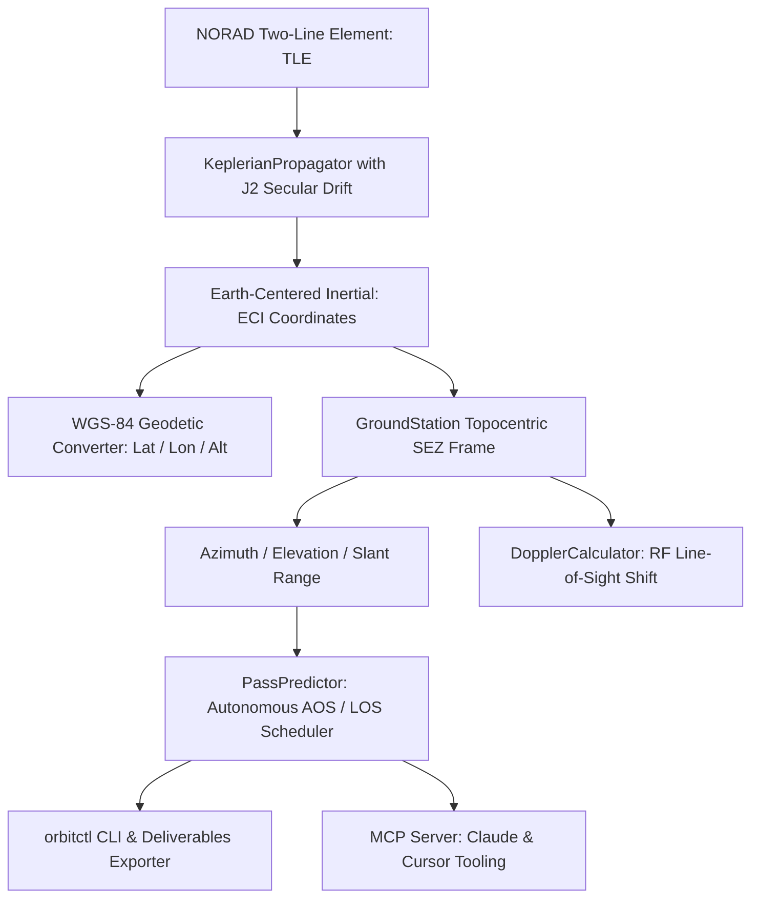

# orbital-telemetry-agent

[](https://github.com/perfectalone375/orbital-telemetry-agent/actions)
[](https://opensource.org/licenses/MIT)
[](https://www.python.org/downloads/)
[](deliverables/mcp_orbital_guide.md)
[](https://github.com/astral-sh/ruff)
[](tests/)

**`orbital-telemetry-agent`** is an open-source, high-precision autonomous satellite orbit propagator, ground station pass predictor, and **Model Context Protocol (MCP)** server in Python.

---

## Architecture Overview



---

## Core Capabilities

1. **Analytical Keplerian Propagator with $J_2$ Secular Oblateness:**
   * Models the non-spherical gravitational harmonic perturbation of Earth ($J_2 = 1.08263 \times 10^{-3}$).
   * Predicts nodal regression rate ($\dot{\Omega}$) and argument of perigee precession ($\dot{\omega}$).
2. **WGS-84 Geodetic Coordinate Transformations:**
   * Converts Earth-Centered Inertial (ECI) coordinates to Earth-Centered Earth-Fixed (ECEF) via Greenwich Mean Sidereal Time (GMST).
   * Implements Bowring's closed-form algorithm for precise geodetic latitude, longitude, and ellipsoidal altitude.
3. **Autonomous Ground Station Pass Scheduler:**
   * Detects Acquisition of Signal (AOS), Loss of Signal (LOS), max elevation, and pass duration over any earth station.
4. **RF Doppler Frequency Shift:**
   * Calculates instantaneous line-of-sight range rate and RF frequency offset for satellite communications (UHF/VHF/S-Band).
5. **Orbital Maneuvers & Hohmann Transfer $\Delta v$ Budgets:**
   * Two-impulse coplanar Hohmann transfer calculating periapsis/apoapsis burns and transfer duration ($t_{\text{tof}}$).
   * Orbital inclination plane change $\Delta v_{\text{plane}} = 2 v \sin(\Delta i / 2)$ and combined apogee plane-change optimization.
6. **Model Context Protocol (MCP) Server:**
   * Connects AI coding assistants (**Claude Desktop**, **Cursor**, **Windsurf**, and **Antigravity**) directly to live orbit propagation, ground tracking, and orbital maneuver tools (`calculate_hohmann_transfer`).

---

## Quickstart

```bash
git clone https://github.com/perfectalone375/orbital-telemetry-agent.git
cd orbital-telemetry-agent
python -m venv .venv
source .venv/bin/activate  # On Windows: .venv\Scripts\activate
pip install -e ".[dev]"
```

### CLI Tracking (`orbitctl`)

```bash
# Query current satellite position
orbitctl track --seconds 300

# Predict upcoming passes over Hyderabad Ground Station
orbitctl passes --lat 17.3850 --lon 78.4867 --name "Hyderabad-GS"
```

---

## Model Context Protocol (MCP) Integration

Add to your `claude_desktop_config.json`:

```json
{
  "mcpServers": {
    "orbital-telemetry": {
      "command": "python",
      "args": ["-m", "orbital_telemetry.mcp.server"]
    }
  }
}
```

---

## Automated Test Suite

```bash
pytest -v --cov=orbital_telemetry
```

---

## License

MIT License. Developed by **Gopi Naga Vignesh Thirupati**.
